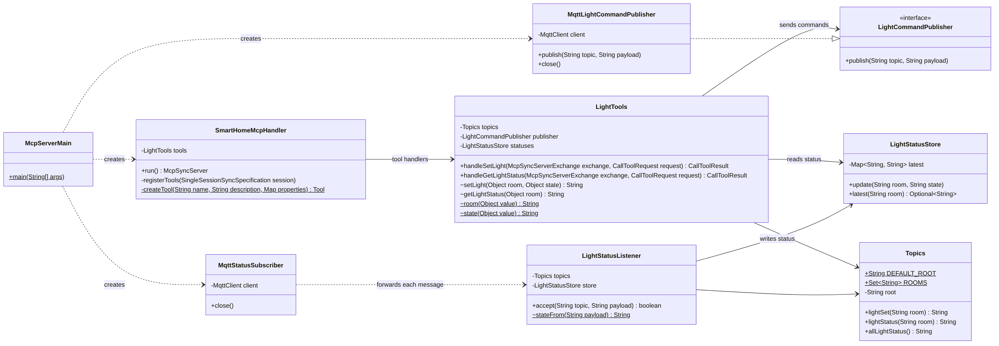

# Mini Smart Home Simulator

CSC 3100 Final Project — Connected Systems. Users control and monitor simulated lights and a
thermostat from a Java Swing dashboard and from an AI assistant. Independent Java applications
communicate through MQTT; the device simulator runs in Docker; a local Java MCP server lets the
AI act on the real system.

> Sections marked *TODO (owner)* are filled in by the teammate who owns that part.

## Team

| Member | GitHub | Subsystem |
|---|---|---|
| Tobin Discoe | sipactivism | Java Swing dashboard |
| Srinitya Doppalapudi | srinityad | Smart device simulator (Docker) |
| Marcus Hauen-Limkilde | MKBHL | MCP server (AI interaction) |
| Anthony Soto | anthony-Soto | Temperature automation & MQTT integration |

## Architecture

*TODO (team): overall diagram — dashboard, simulator (Docker), MCP server, MQTT broker.*

## Build and test

Requires Java 21+ and Maven. From the repository root:

```sh
mvn -B verify          # builds and tests every module (same command CI runs)
```

## MQTT topics and payloads

Broker: `tcp://broker.hivemq.com:1883` (override with `MQTT_BROKER`).
All topics start with a team root (`TOPIC_ROOT`, default `smarthome`). Rooms: `livingroom`, `bedroom`, `kitchen`.

| Topic | Payload | Publisher → Subscriber | QoS / retained |
|---|---|---|---|
| `<root>/<room>/light/set` | `{"state":"ON"}` or `{"state":"OFF"}` | Dashboard, MCP server → Simulator | 1 / no |
| `<root>/<room>/light/status` | `{"state":"ON"}` or `{"state":"OFF"}` | Simulator → Dashboard, MCP server | 1 / yes |
| *thermostat topics* | *TODO (Anthony)* | | |

Commands are not retained (a replayed "ON" would re-fire on reconnect). Status is retained so a
newly started app gets the current state immediately.

## MCP server (AI interaction)

*Owner: Marcus Hauen-Limkilde · module `mcp-server`*

A local Java MCP server that lets an AI assistant (Claude Desktop) control and check the smart
home. It runs over stdio, publishes real MQTT commands, and answers status questions from what the
simulator actually reported — not from hard-coded values.

### Tools

| Tool | Input | Effect / result |
|---|---|---|
| `set_light` | `room` (`livingroom` \| `bedroom` \| `kitchen`), `state` (`ON` \| `OFF`) | Publishes `{"state":...}` to `<root>/<room>/light/set`. Invalid input returns an error message listing valid values; nothing is published. |
| `get_light_status` | `room` | Returns the last state the simulator published on `<root>/<room>/light/status`, or says no status has been reported yet. |

### Run it from Claude Desktop

1. Build the jar:
   ```sh
   mvn -q package        # creates mcp-server/target/mcp-server.jar
   ```
2. Find the absolute paths Claude Desktop needs:
   ```sh
   echo "$(/usr/libexec/java_home)/bin/java"
   realpath mcp-server/target/mcp-server.jar
   ```
3. Add the server to `~/Library/Application Support/Claude/claude_desktop_config.json`
   (macOS; on Windows `%APPDATA%\Claude`). Add a top-level `mcpServers` entry, keeping anything
   already in the file:
   ```json
   "mcpServers": {
     "smart-home": {
       "command": "/absolute/path/to/bin/java",
       "args": ["-jar", "/absolute/path/to/mcp-server.jar"],
       "env": { "TOPIC_ROOT": "smarthome" }
     }
   }
   ```
4. Quit Claude Desktop completely (⌘Q) and reopen it. Ask: *"Turn on the living room light"*,
   then *"Is the living room light on?"*

### Verify without the simulator

Open the [HiveMQ web client](https://www.hivemq.com/demos/websocket-client/), connect, and
subscribe to `<root>/#`:

- After `set_light`, a message appears on `<root>/livingroom/light/set`.
- Publish `{"state":"ON"}` to `<root>/livingroom/light/status`; `get_light_status` now reports ON.

### Design



- **Observer:** `MqttStatusSubscriber` registers a callback with the broker; each status message is
  pushed to `LightStatusListener`, which updates `LightStatusStore`. The MCP server never polls.
- **Programming to an interface:** `LightTools` depends on `LightCommandPublisher`, not on Paho.
  Production uses `MqttLightCommandPublisher`; tests pass a lambda that records messages.
- **Thread safety:** the MQTT thread writes `LightStatusStore` while the MCP thread reads it, so it
  uses a `ConcurrentHashMap`.
- **stdout is reserved** for MCP JSON-RPC; the server logs only to stderr.

### Tests and metrics

11 JUnit 5 tests, no broker required (`LightToolsTest`, `LightStatusListenerTest`): valid commands
publish exactly once, input is normalized, invalid rooms/states publish nothing, status updates are
stored, and malformed or unrelated messages are ignored.
Metrics (A, I, D, CC): see [docs/mcp-server/metrics.md](docs/mcp-server/metrics.md).

### Known limitations

- `get_light_status` reports the last *reported* state; if the simulator is offline, that state
  may be stale.
- Only lights are exposed to the AI; thermostat tools are not implemented.

## Swing dashboard

*TODO (Tobin)*

## Device simulator and Docker

*TODO (Srinitya)*

## Temperature automation

*TODO (Anthony)*

## Release

*TODO (team): tagged GitHub Release with runnable jars and Docker instructions.*
